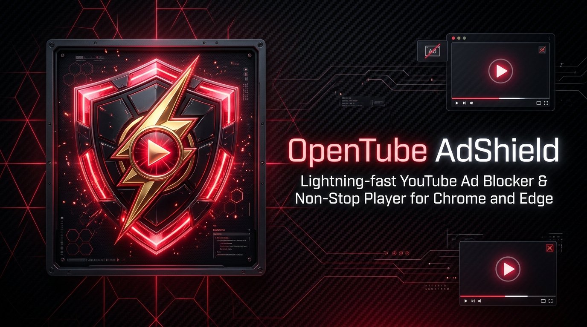

<p align="center">
  
</p>

# 🛡️ OpenTube AdShield

> **A high-performance, open-source YouTube ad blocker and non-stop player for Chrome and Edge.**  
> Blazingly fast, undetectable, 100% client-side, and zero telemetry.

[](LICENSE)
[](manifest.json)
[](INSTALL.md)

---

## 🚀 Key Features

* **🎵 Non-Stop Music & Autoplay**: Prevents YouTube from auto-pausing when autoplaying to the next video, auto-dismisses "Video paused. Continue watching?" inactivity popups, and preserves background music streaming when away from your PC.
* **⚡ Ultra Fast-Forward (16x)**: Instantly accelerates unskippable video ads to 16x speed and mutes audio, clearing them in milliseconds.
* **⏭️ Auto-Click Skip**: Automatically finds and clicks skip buttons (`.ytp-ad-skip-button-modern`, `.ytp-skip-ad-button`) the instant they appear.
* **🛡️ Anti-Adblock Modal Bypass**: Automatically detects and dismisses YouTube's *"Ad blockers violate YouTube's Terms of Service"* enforcement popup and restores playback seamlessly.
* **🧹 Cosmetic Filtering**: Strips home feed ads, masthead promotions, sidebar companion ads, search promos, and video overlays with zero layout shifts.
* **📱 Sponsored Shorts Auto-Skip**: Detects sponsored clips in the YouTube Shorts feed and automatically scrolls to the next reel.
* **📊 Live Dashboard**: Sleek dark-mode popup displaying live stats on ads skipped, banners blocked, and estimated time saved.
* **🔒 100% Privacy & Open Source**: No external tracking, no servers, zero telemetry. All code runs locally in your browser.

---

## 📥 Installation

Installing OpenTube AdShield takes less than 60 seconds on any Chromium browser.

👉 **[Click here for the Detailed Step-by-Step Installation Guide (Chrome, Edge, Brave, Opera)](INSTALL.md)**

### Quick Setup:
1. **Clone or Download** this repository:
   ```bash
   git clone https://github.com/Spec-Pilot/open-tube.git
   ```
   *(Or download the [ZIP archive](https://github.com/Spec-Pilot/open-tube/archive/refs/heads/main.zip) and extract it)*

2. Open your browser's extensions manager:
   * **Chrome**: `chrome://extensions`
   * **Edge**: `edge://extensions`
   * **Brave**: `brave://extensions`

3. Turn **ON** the **"Developer mode"** toggle (top-right corner).
4. Click **"Load unpacked"** and select the folder containing `manifest.json`.
5. Open [YouTube](https://www.youtube.com) and enjoy clean, uninterrupted video & music streaming!

---

## 🛠️ Architecture & How It Works

Traditional ad blockers that block network requests often trigger YouTube's anti-adblock watchdog, resulting in stuck videos, frozen ads, or repeated video pauses. OpenTube AdShield uses a **zero-ad pre-emptive sterilization architecture**:

```
┌─────────────────────────────────────────────────────────────┐
│                     OpenTube AdShield                       │
├─────────────────────────┬───────────────────────────────────┤
│ 1. Zero-Ad Sterilization│ Strips adPlacements & adSlots at  │
│    (MAIN World)         │ source (ytInitialPlayerResponse)  │
├─────────────────────────┼───────────────────────────────────┤
│ 2. Stealth Mock API     │ Intercepts /player, /next & stats │
│    & Tracker Evasion    │ Fakes 200 OK without errors       │
├─────────────────────────┼───────────────────────────────────┤
│ 3. Player Engine Hook   │ Calls player.skipAd() in 0ms &    │
│    & Anti-Pause Shield  │ auto-resumes unauthorized pauses  │
├─────────────────────────┼───────────────────────────────────┤
│ 4. DeclarativeNetRequest│ Blocks 3rd-party ad networks      │
│    (DNR V3)             │ (doubleclick, googleadservices)   │
├─────────────────────────┼───────────────────────────────────┤
│ 5. Cosmetic Hiding      │ Removes all banners, overlays &   │
│                         │ skip buttons from visual viewport │
└─────────────────────────┴───────────────────────────────────┘
```

1. **Pre-Emptive Data Sterilization (`scripts/inject.js`)**: Executes in Chrome's `MAIN` world at `document_start`. Intercepts `window.ytInitialPlayerResponse` and `window.fetch` to remove `adPlacements`, `adSlots`, and `playerAds` before YouTube's player initializes. YouTube loads the video identical to YouTube Premium—ads are never scheduled or opened.
2. **Stealth Mocking & Tracker Evasion**: Swallows tracking requests (`/api/stats/ads`, `/pagead/`, `/ptracking`) and returns synthetic 200 OK responses, completely bypassing YouTube's anti-adblock detection.
3. **Player Engine Control & Anti-Pause Watchdog**: Direct hook into `#movie_player`. If an ad state ever attempts to activate, it calls `player.skipAd()` in 0ms. If YouTube tries to pause playback during an ad transition, the anti-pause shield detects the non-user pause and immediately resumes the video.
4. **Cosmetic Filtering (`styles/content.css`)**: Pure CSS rules hide ad slots, banners, and player overlays with zero layout shifts.

---

## 📁 Project Structure

```
d:/youtube/
├── manifest.json              # Chrome Manifest V3 configuration
├── README.md                  # Project documentation & installation guide
├── LICENSE                    # MIT open-source license
├── CONTRIBUTING.md            # Guidelines for open-source contributors
├── rules/
│   └── rules.json             # DeclarativeNetRequest ruleset (third-party ads)
├── scripts/
│   ├── inject.js              # MAIN world player response sterilizer & anti-pause
│   ├── content.js             # Content script for DOM cleaning, shorts & stats
│   ├── background.js          # Service worker for metrics & badge counters
│   └── generate_icons.ps1     # High-resolution icon generator
├── styles/
│   └── content.css            # Cosmetic hiding rules for overlays & banners
├── popup/
│   ├── popup.html             # Popup dashboard interface
│   ├── popup.css              # Modern dark-mode styling
│   └── popup.js               # Reactive settings and stats controller
└── tests/
    ├── test_inject.js         # Unit test suite for player sterilization
    └── test_extension.js      # Chrome CDP automated integration test
```

---

## ⚙️ Configurable Options

Click the extension icon in your browser toolbar to access the control panel:

| Setting | Default | Description |
| :--- | :--- | :--- |
| **Ad Protection (Master)** | `ON` | Master toggle to enable or pause all ad blocking functions. |
| **Ultra Fast-Forward** | `ON` | Speeds unskippable pre-roll and mid-roll ads up to 16x. |
| **Auto-Click Skip** | `ON` | Clicks skip buttons the moment they are rendered by the player. |
| **Block Banners & Feeds** | `ON` | Hides feed ads, mastheads, and sponsored search results. |
| **Bypass Adblock Popups** | `ON` | Dismisses YouTube's anti-adblock enforcement dialogs. |
| **Non-Stop Music & Autoplay** | `ON` | Prevents auto-pausing on next video and bypasses idle popups. |

---

## 🤝 Contributing

Contributions are welcome! Please follow these steps:

1. Fork the repository.
2. Create your feature branch (`git checkout -b feature/amazing-feature`).
3. Test your changes locally in Chrome via `chrome://extensions`.
4. Commit your changes (`git commit -m "Add amazing feature"`).
5. Push to the branch (`git push origin feature/amazing-feature`).
6. Open a Pull Request.

---

## ⚠️ Disclaimer

OpenTube AdShield is an independent, community-driven open-source project created for educational and productivity purposes. YouTube™ is a registered trademark of Google LLC. This project is not affiliated with, endorsed by, or sponsored by YouTube or Google LLC.

---

## 📄 License

Distributed under the **MIT License**. See [`LICENSE`](LICENSE) for more information.
